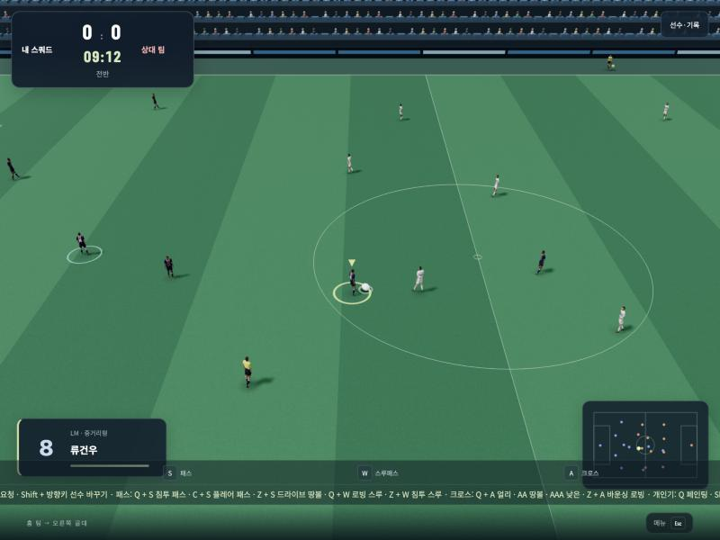
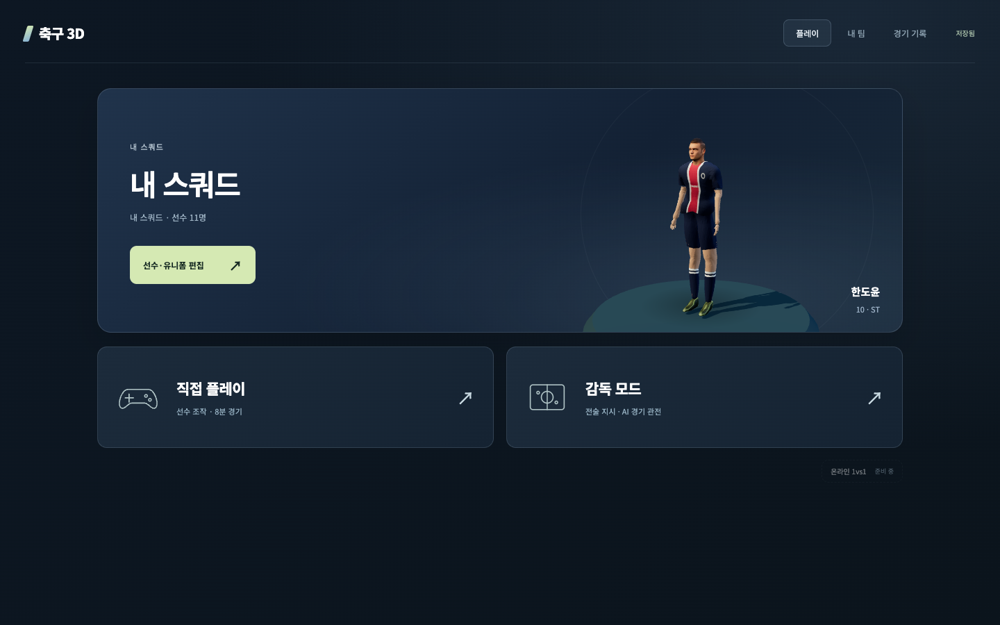

<div align="center">

# ⚽ 축구 3D

**브라우저에서 바로 즐기는 3D 축구 게임**
피파 모티브 키 배치와 중계 카메라로, 익숙한 손맛 그대로 플레이하세요.

[](https://yeoyunu3-cloud.github.io/football-3d/)
&nbsp;




<sub>경기 화면 · 중계 카메라 시점 · 왼쪽 아래 카드에 선수 유형 표시</sub>

</div>

---

## ✨ 특징

<table>
<tr>
<td width="50%" valign="top">

### 🎮 플레이
- **직접 플레이** — 선수를 직접 조작하는 8분 경기
- **감독 모드** — 전술을 지시하고 AI 경기를 관전
- **중계 카메라** — 경기장 폭의 절반이 보이는 TV 중계 시점
- **실제 규격 경기장** — 넓은 경기장에서 선수 간격도 자연스럽게
- **세리머니 스킵** — 골 세리머니 중 `S`로 바로 킥오프

</td>
<td width="50%" valign="top">

### ⌨️ 조작
- **피파 모티브 키 배치** — 방향키 + S·W·A·D
- **개인기 16가지** — 헛다리·엘라스티코·룰렛·레인보우 등
- **슛·패스 페이크** — 차는 척하다 꺾어서 수비 속이기
- **패스·크로스 변형 9가지** — 침투 패스, 로빙 스루, 얼리 크로스 등
- **차징 비례 킥** — 누른 시간만큼 패스·슛 세기가 달라짐

</td>
</tr>
<tr>
<td width="50%" valign="top">

### 🧬 선수
- **선수 유형 6가지** — 타깃형·스피드형·중거리형 등
- **유형별 능력 차이** — 속도·민첩성·몸싸움·헤딩·중거리·패스
- **빠른 패스** — 풀 차징하면 시원하게 뻗는 땅볼 패스와 스루패스
- **선수 편집** — 이름·등번호·포지션·유형·키·몸무게·유니폼

</td>
<td width="50%" valign="top">

### 🧠 AI · 규칙
- **실제 축구 원리 기반 AI** — 촘촘한 수비 블록, 한 명만 압박, 넓게 벌리는 공격
- **오프사이드** — 패스 순간 기준 · 스로인·코너킥·골킥 예외
- **태클 & 슬라이딩** — 뒤에서 들어가면 반칙
- **세트피스 & 승부차기** — 코너킥·프리킥·페널티 지원

</td>
</tr>
</table>

> 🔊 드리블 터치·볼 컨트롤·킥 소리는 오디오 파일 없이 실시간으로 합성합니다.

---

## 🧬 선수 유형

선수마다 유형이 있고, 유형에 따라 경기에서 움직임이 달라집니다. **내 팀 → 선수 편집**에서 유형을 바꿀 수 있고, 바꾸면 키·몸무게도 그 유형에 맞게 바뀝니다.

| 유형 | 체격 | 속도 | 민첩 | 몸싸움 | 헤딩 | 중거리 | 패스 |
|---|:---:|:---:|:---:|:---:|:---:|:---:|:---:|
| 🗼 **타깃형** | 192cm · 88kg | ▰▰▱▱▱ | ▰▱▱▱▱ | ▰▰▰▰▰ | ▰▰▰▰▰ | ▰▰▰▱▱ | ▰▰▱▱▱ |
| ⚡ **스피드형** | 169cm · 64kg | ▰▰▰▰▰ | ▰▰▰▰▰ | ▰▱▱▱▱ | ▰▱▱▱▱ | ▰▰▱▱▱ | ▰▰▰▱▱ |
| 🎯 **중거리형** | 179cm · 75kg | ▰▰▰▱▱ | ▰▰▰▱▱ | ▰▰▰▱▱ | ▰▰▰▱▱ | ▰▰▰▰▰ | ▰▰▰▱▱ |
| 🛡️ **파이터형** | 188cm · 85kg | ▰▰▱▱▱ | ▰▰▱▱▱ | ▰▰▰▰▱ | ▰▰▰▰▱ | ▰▰▱▱▱ | ▰▰▱▱▱ |
| 🧠 **플레이메이커** | 176cm · 70kg | ▰▰▰▱▱ | ▰▰▰▰▱ | ▰▰▱▱▱ | ▰▰▱▱▱ | ▰▰▰▰▱ | ▰▰▰▰▰ |
| ⚖️ **밸런스형** | 180cm · 76kg | ▰▰▰▱▱ | ▰▰▰▱▱ | ▰▰▰▱▱ | ▰▰▰▱▱ | ▰▰▰▱▱ | ▰▰▰▱▱ |

<details>
<summary><b>능력치가 경기에 주는 영향</b></summary>

| 능력 | 영향 |
|---|---|
| 속도 | 최고 달리기 속도 |
| 민첩 | 가속과 방향 전환 |
| 몸싸움 | 어깨 싸움에서 밀어내기 · 공을 지키거나 빼앗기 |
| 헤딩 | 점프 높이 · 공중볼 경합에서 이기기 |
| 중거리 | 먼 거리 슛의 세기 · 키퍼 반응 지연 · AI가 슛을 시도하는 거리 |
| 패스 | 땅볼 패스와 스루패스 속도 |

기본 배치 (4-4-2): 투톱은 **타깃형 + 스피드형**, 측면은 **스피드형**, 중원은 **플레이메이커 + 중거리형**, 센터백은 **타깃형 + 파이터형**입니다.

</details>

> 조작 중인 선수의 유형은 왼쪽 아래 선수 카드에 `ST · 타깃형`처럼 표시됩니다.

---

## 🎮 조작법

> 기본 조작은 **피파 모티브 · 방향키**입니다. 경기 준비 화면의 **조작 설정**에서 기존 WASD 방식으로 바꿀 수 있습니다.

### 🔵 기본

| 키 | 동작 |
|:---:|---|
| `방향키` | 이동 |
| `E` | 전력 질주 |
| `S` | 짧은 패스 |
| `W` | 스루패스 |
| `A` | 로빙 패스 · 크로스 |
| `D` | 슛 · 헤딩 |
| `Ctrl` | 퍼스트 터치 — 공을 앞으로 밀고 따라 달리기 |
| `Esc` | 경기 메뉴 |

### 🔋 차징

패스·스루패스·슛은 **키를 누르고 있는 시간만큼 세게** 나갑니다. 살짝 누르면 부드럽게, 꾹 누르면(약 0.6초) 최대 세기로 찹니다.

| 킥 | 살짝 탭 | 절반 | 풀 차징 |
|---|:---:|:---:|:---:|
| 짧은 패스 `S` | ▰▱▱▱▱ | ▰▰▱▱▱ | ▰▰▰▱▱ |
| 스루패스 `W` | ▰▰▱▱▱ | ▰▰▰▱▱ | ▰▰▰▰▱ |
| 일반 슛 `D` | ▰▰▱▱▱ | ▰▰▰▱▱ | ▰▰▰▰▱ |
| 파워슛 `F` + `D` | ▰▰▰▱▱ | ▰▰▰▰▱ | ▰▰▰▰▰ |

> 풀 차징은 살짝 탭보다 공이 약 2배 빠릅니다. 짧은 거리는 가볍게, 먼 거리·강슛은 길게 누르세요.

### 🎯 패스

| 키 | 동작 |
|:---:|---|
| `Q` + `S` | 침투 패스 — 받는 선수 앞 공간으로 |
| `C` + `S` | 플레어 패스 — 바깥발로 감는 패스 |
| `Z` + `S` | 드라이브 땅볼 패스 — 빠르고 강한 땅볼 패스 |
| `Q` + `W` | 로빙 스루 — 수비 머리 위로 띄우는 스루 |
| `Z` + `W` | 침투 스루 — 빠르고 강한 땅볼 스루 |

### 🌀 크로스

| 키 | 동작 |
|:---:|---|
| `Q` + `A` | 얼리 크로스 — 낮고 빠르게 일찍 올리는 크로스 |
| `A` `A` | 땅볼 크로스 |
| `A` `A` `A` | 낮은 크로스 — 무릎 높이로 깔리는 크로스 |
| `Z` + `A` | 바운싱 로빙 패스 — 바닥에 튀기며 가는 로빙 패스 |

### ⚽ 슛

| 키 | 슛 |
|:---:|---|
| `D` | 일반 슛 |
| `D` `D` | 깔아차기 |
| `Z` + `D` | 감아차기 |
| `C` + `D` | 플레어 슛 |
| `F` + `D` | 파워슛 |
| `Q` + `D` | 칩슛 |

### 🪄 개인기

> 화살표는 **오른쪽으로 공격할 때** 기준입니다 (`→` 상대 골대 쪽, `←` 뒤, `↑` 왼쪽, `↓` 오른쪽). 왼쪽으로 공격할 때는 좌우·상하가 반대입니다.
> `Shift`를 누른 채 방향키를 빠르게 차례로 누르세요.

| 키 | 개인기 |
|:---:|---|
| `Q` | 노 터치 페인팅 |
| `Q` + `E` | 노 터치 큰 페인팅 |
| `Shift` + `↑` / `↓` | 속임 동작 (왼쪽 / 오른쪽) |
| `Shift` + `↑` / `↓` 길게 | 사이드 스텝 |
| `Shift` + `←` 길게 | 퀵 볼 롤 |
| `Shift` + `←` · `Z` + `←` | 드래그 백 |
| `Shift` + `→` `↑` / `→` `↓` | 헛다리 |
| `Shift` + `↑` `→` / `↓` `→` | 역헛다리 |
| `Shift` + `→` `←` | 힐 플릭 |
| `Shift` + `←` `↑` / `←` `↓` | 턴 |
| `Shift` + `↓` `←` `↑` / `↑` `←` `↓` | 엘라스티코 / 역 엘라스티코 |
| `Shift` + `←` `↑` `→` `↓` / `←` `↓` `→` `↑` | 룰렛 (오른쪽 / 왼쪽) |
| `Shift` + `→` `→` `→` | 볼 띄우기 |
| `Shift` + `←` `→` `→` | 레인보우 |
| `D` 후 `S` | 슛 페이크 — 방향키 쪽으로 꺾기, 뒤로 누르면 스쿱 턴 |
| `A` 후 `S` | 패스 페이크 |

> 개인기를 하는 동안에는 공을 뺏기지 않고, 가까운 수비수가 잠깐 속아서 느려집니다.

### 🏃 침투

| 키 | 동작 |
|:---:|---|
| `1` `2` `3` `4` | 각도 침투 — 45° · 80° · 135° · 170° (경기장에 방향 화살표 표시) |

### 🛡️ 수비

| 키 | 동작 |
|:---:|---|
| `D` | 스탠딩 태클 |
| `A` | 슬라이딩 태클 |
| `S` | 선수 변경 |
| `Shift` + `방향키` | 그 방향에 있는 동료로 선수 바꾸기 |
| `Q` | 수비 도움 요청 — 동료 한 명이 공 쪽으로 압박 |

### 🧤 기타

| 키 | 동작 |
|:---:|---|
| `E` + `C` | 패스·슛 입력 취소 |
| `W` | 골키퍼 공 놓기 |
| `S` / `A` | 스로인 짧게 / 길게 |
| `S` | 골 세리머니 건너뛰기 — 바로 킥오프 |

> 💡 **팁** — `A`·`D`를 한 번만 누르면 다음 탭을 기다리느라 아주 짧게(0.17초) 늦게 찹니다.
> 💡 **팁** — 침투 각도는 상대 골대를 바라봤을 때 왼쪽 터치라인이 0°, 골대 정면이 90°, 오른쪽 터치라인이 180°입니다.
> 💡 **팁** — 침투를 지시한 선수는 패스가 나가기 전까지 오프사이드 라인에 맞춰 기다립니다. 패스는 평소처럼 방향키로 겨눈 선수에게 갑니다.

---

## 🖼️ 화면

<div align="center">

<br><sub>홈 화면 · 내 스쿼드 · 직접 플레이 / 감독 모드</sub>
</div>

---

## 🚀 로컬에서 실행하기

빌드 과정 없이 정적 파일만으로 동작합니다. ES 모듈을 쓰기 때문에 `index.html`을 더블클릭하지 말고 간단한 서버로 열어 주세요.

```bash
git clone https://github.com/yeoyunu3-cloud/football-3d.git
cd football-3d
python3 -m http.server 8765
```

브라우저에서 <http://localhost:8765> 를 열면 됩니다.

---

## 🗂️ 구조

```
football-3d/
├── index.html            # 화면 구성
├── game.js               # 렌더링 · 입력 · UI
├── controls.js           # 키 배치 프리셋 · 개인기 입력 패턴
├── match.js              # 경기 엔진 (패스 · 슛 · 태클 · 침투 · 개인기)
├── player-traits.js      # 선수 유형 · 능력치 (속도 · 민첩 · 몸싸움 · 헤딩 · 중거리 · 패스)
├── ball-flight.js        # 공 궤적 (감아차기 · 플레어 슛 · 깔아차기)
├── ball-sound.js         # 공 소리 합성 (Web Audio)
├── real-player-model.js  # 선수 3D 모델 · 애니메이션
├── roster.js             # 스쿼드 · 선수 정보 저장
├── team-shape.js         # 팀 대형 AI (수비 블록 · 압박 조건 · 공격 폭 · 지원 · 자동 침투)
├── team-ai.js · attacking.js · keeper*.js   # AI
├── assets/players/       # 선수 모델 · 모션 · 얼굴 텍스처
└── vendor/               # Three.js r170
```

---

<div align="center">

**⚠️ 고지**
이 프로젝트는 축구 게임의 조작 방식에서 모티브를 얻은 개인 프로젝트입니다.
특정 상용 게임·게임사와 관련이 없으며, 공식 제품이 아닙니다.

</div>
