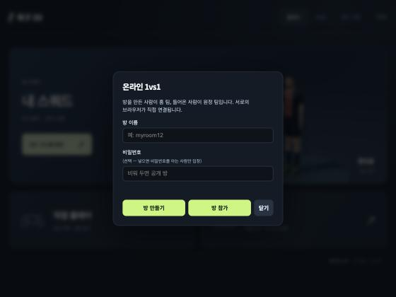
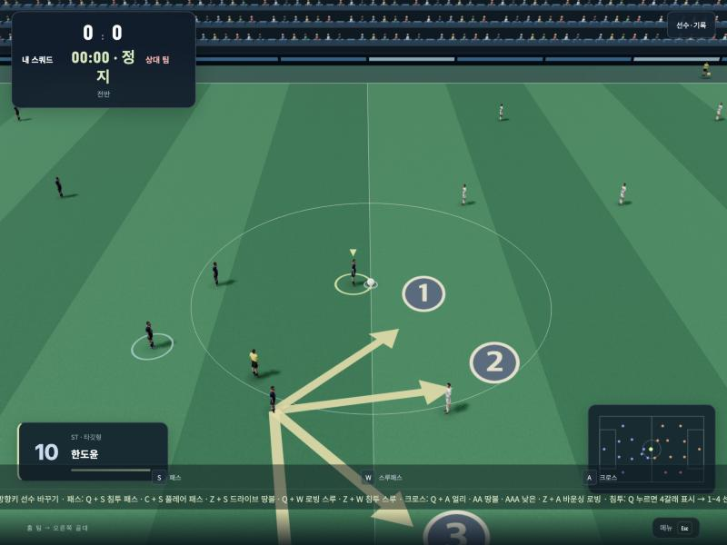
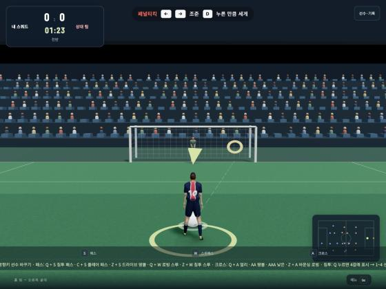
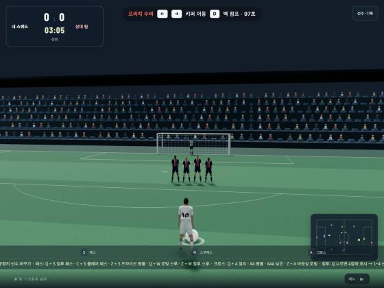
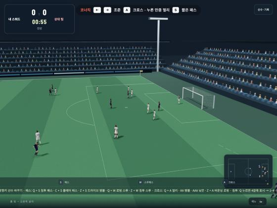

<div align="center">

# ⚽ 축구 3D

**브라우저에서 바로 즐기는 3D 축구 게임**
피파 모티브 키 배치와 중계 카메라로, 익숙한 손맛 그대로 플레이하세요.

[](https://yeoyunu3-cloud.github.io/football-3d/)
&nbsp;


<sub>경기 화면 · 중계 카메라 시점 · 왼쪽 아래 카드에 선수 유형 표시</sub>

</div>

---

## ✨ 특징

<table>
<tr>
<td width="50%" valign="top">

### 🎮 플레이
- **직접 플레이** — 선수를 직접 조작하는 8분 경기
- **감독 모드** — 전술을 지시하고 AI 경기를 관전
- **온라인 1vs1** — 방 목록에서 골라 들어가는 친구 대전 · 비밀번호 방
- **중계 카메라** — 공 주변 선수들이 모두 화면에 들어오도록 자동으로 줌
- **실제 규격 경기장** — 넓은 경기장에서 선수 간격도 자연스럽게
- **골 다시보기** — 세리머니 뒤에 골 장면을 슬로 모션으로 재생 · `S`로 세리머니와 다시보기를 각각 건너뛰기

</td>
<td width="50%" valign="top">

### ⌨️ 조작
- **피파 모티브 키 배치** — 방향키 + S·W·A·D
- **개인기 35가지** — 스텝오버·엘라스티코·룰렛·레인보우·엘 토네이도 등
- **슛·패스 페이크** — 차는 척하다 꺾어서 수비 속이기
- **패스·크로스 변형 9가지** — 침투 패스, 로빙 스루, 얼리 크로스 등
- **차징 비례 킥** — 누른 시간만큼 패스·슛 세기가 달라짐
- **원터치 킥** — 굴러오는 공을 바로 차면 공의 힘이 더해져 더 빠르게
- **침투 메뉴** — `Q`로 4갈래 화살표를 띄우고 `1`~`4`로 방향 선택

</td>
</tr>
<tr>
<td width="50%" valign="top">

### 🧬 선수
- **선수 유형 7가지** — 타깃형·스피드형·트릭스터·중거리형 등
- **유형별 능력 차이** — 속도·민첩성·몸싸움·헤딩·중거리·패스
- **빠른 패스** — 풀 차징하면 시원하게 뻗는 땅볼 패스와 스루패스
- **신특 17종** — 라인 브레이커·레이저 슈터·파이터 등, 선수당 최대 2개
- **아크로바틱 슛** — 발리 · 시저스 킥 · 바이시클 킥
- **선수 편집** — 이름·등번호·포지션·유형·신특·키·몸무게·유니폼

</td>
<td width="50%" valign="top">

### 🧠 AI · 규칙
- **실제 축구 원리 기반 AI** — 촘촘한 수비 블록, 한 명만 압박, 넓게 벌리는 공격
- **오프사이드** — 패스 순간 기준 · 스로인·코너킥·골킥 예외
- **태클 & 슬라이딩** — 뒤에서 들어가면 반칙
- **프리킥 · 페널티킥 · 코너킥** — 공 뒤 시점으로 직접 조준해서 차고, 수비 때는 키퍼와 수비벽을 조작
- **1대1 키퍼** — 박스 안으로 드리블해 오면 키퍼가 발밑으로 다이빙

</td>
</tr>
</table>

> 🔊 드리블 터치·볼 컨트롤·킥 소리는 오디오 파일 없이 실시간으로 합성합니다.

---

## 🧬 선수 유형

선수마다 유형이 있고, 유형에 따라 경기에서 움직임이 달라집니다. **내 팀 → 선수 편집**에서 유형을 바꿀 수 있고, 바꾸면 키·몸무게도 그 유형에 맞게 바뀝니다.

| 유형 | 체격 | 개인기 | 속도 | 민첩 | 몸싸움 | 헤딩 | 중거리 | 패스 |
|---|:---:|:---:|:---:|:---:|:---:|:---:|:---:|:---:|
| 🗼 **타깃형** | 192cm · 88kg | ★★ | ▰▰▱▱▱ | ▰▱▱▱▱ | ▰▰▰▰▰ | ▰▰▰▰▰ | ▰▰▰▱▱ | ▰▰▱▱▱ |
| ⚡ **스피드형** | 169cm · 64kg | ★★★★ | ▰▰▰▰▰ | ▰▰▰▰▰ | ▰▱▱▱▱ | ▰▱▱▱▱ | ▰▰▱▱▱ | ▰▰▰▱▱ |
| 🎩 **트릭스터** | 173cm · 67kg | ★★★★★ | ▰▰▰▰▱ | ▰▰▰▰▰ | ▰▱▱▱▱ | ▰▱▱▱▱ | ▰▰▰▱▱ | ▰▰▰▱▱ |
| 🎯 **중거리형** | 179cm · 75kg | ★★★ | ▰▰▰▱▱ | ▰▰▰▱▱ | ▰▰▰▱▱ | ▰▰▰▱▱ | ▰▰▰▰▰ | ▰▰▰▱▱ |
| 🛡️ **파이터형** | 188cm · 85kg | ★★ | ▰▰▱▱▱ | ▰▰▱▱▱ | ▰▰▰▰▱ | ▰▰▰▰▱ | ▰▰▱▱▱ | ▰▰▱▱▱ |
| 🧠 **플레이메이커** | 176cm · 70kg | ★★★★ | ▰▰▰▱▱ | ▰▰▰▰▱ | ▰▰▱▱▱ | ▰▰▱▱▱ | ▰▰▰▰▱ | ▰▰▰▰▰ |
| ⚖️ **밸런스형** | 180cm · 76kg | ★★★ | ▰▰▰▱▱ | ▰▰▰▱▱ | ▰▰▰▱▱ | ▰▰▰▱▱ | ▰▰▰▱▱ | ▰▰▰▱▱ |

<details>
<summary><b>능력치가 경기에 주는 영향</b></summary>

| 능력 | 영향 |
|---|---|
| 속도 | 최고 달리기 속도 |
| 민첩 | 가속과 방향 전환 |
| 몸싸움 | 어깨 싸움에서 밀어내기 · 공을 지키거나 빼앗기 |
| 헤딩 | 점프 높이 · 공중볼 경합에서 이기기 |
| 중거리 | 먼 거리 슛의 세기 · 키퍼 반응 지연 · AI가 슛을 시도하는 거리 |
| 패스 | 땅볼 패스와 스루패스 속도 |
| 개인기 | 쓸 수 있는 개인기 등급 (★ 수) · AI가 개인기를 쓰는 빈도 |

기본 배치 (4-4-2): 투톱은 **타깃형 + 스피드형**, 측면은 **트릭스터 + 스피드형**, 중원은 **플레이메이커 + 중거리형**, 센터백은 **타깃형 + 파이터형**입니다.

</details>

> 조작 중인 선수의 유형은 왼쪽 아래 선수 카드에 `ST · 타깃형`처럼 표시됩니다.

---

## 🏅 신특 (특성)

선수 유형과 별개로, 선수마다 **신특을 최대 2개** 달 수 있습니다. **내 팀 → 선수 편집**에서 고릅니다. 골키퍼는 골키퍼 신특만 달 수 있습니다.

| 분류 | 신특 | 효과 |
|---|---|---|
| 공격 | **라인 브레이커** | 뒷공간 침투를 더 자주·빠르게 하고 오프사이드 라인에 바짝 붙어 기다림 |
| | **트릭스터** | 개인기가 20% 빨리 끝나 다음 동작으로 바로 이어짐 |
| | **스피드스터** | 공을 몰 때 가속이 빠르고 드리블 속도가 줄지 않음 |
| | **크로스 포처** | 크로스·컷백 때 박스 안으로 파고드는 속도가 빨라짐 |
| | **아크로바틱 피니셔** | 공중볼에 바이시클 킥·시저스 킥이 나가고 발리 슛이 강해짐 |
| 슛·패스 | **레이저 슈터** | `D` · `D` `D` 슛이 낮고 빠르게 뻗음 |
| | **커맨더** | 로빙 스루(`Q`+`W`)에 백스핀이 걸려 빈 공간에 멈추듯 떨어짐 |
| | **2개의 심장** | 질주할 때 체력이 40% 덜 닳음 |
| 수비 | **파이터** | 몸싸움과 공 뺏기에 강함 |
| | **프레데터** | 수비 때 방향 전환이 빠르고 개인기에 덜 속음 |
| | **와일드 태클러** | 스탠딩 태클 범위가 넓고 옆·뒤 태클의 반칙이 줄어듦 |
| | **체이서** | 공을 뺏겼을 때 수비 진영으로 돌아오는 속도가 빠름 |
| | **블로커** | 슛 길목에 있으면 몸을 던져 막아냄 |
| | **타이탄** | 공중볼 경합에서 더 높이 뛰고 더 잘 이김 |
| 골키퍼 | **GK 데드아이** | 중거리 슛에 더 빨리 반응함 |
| | **GK 빠른 반응** | 1대1에서 더 멀리서, 더 빨리 뛰어나와 덮침 |
| | **GK 공중볼 장악** | 크로스·코너킥을 더 넓은 범위에서 처리함 |

### 🤸 아크로바틱 슛

공이 떠 있을 때 `D`를 누르면 공 높이에 따라 다른 슛이 나갑니다. 동작은 디딤 → 도약 → 공이 도착하는 순간 임팩트 → 넘어지며 착지 → 일어나기 순서로 이어지고, 도약하는 동안 선수가 공이 올 자리로 조금씩 움직여 발이 공에 정확히 맞습니다.

| 공 높이 | 슛 | 조건 |
|---|---|---|
| 무릎~허리 | **발리 슛** | 누구나 (아크로바틱 피니셔는 더 강함) |
| 가슴 | **시저스 킥** | 아크로바틱 피니셔 |
| 머리 위 | **바이시클 킥** | 아크로바틱 피니셔 |
| 그 외 | 헤딩 | 누구나 |

---

## 🌐 온라인 1vs1

홈 화면의 **온라인 1vs1**을 누르면 **방 목록**이 보입니다. 목록에서 방을 눌러 바로 들어가거나, 새 방을 만들 수 있습니다. 서버 없이 두 사람의 브라우저가 직접 연결됩니다(WebRTC).

<div align="center">

</div>

| 단계 | 방법 |
|---|---|
| 방 만들기 | 방 이름(2~20자)을 정하고 **방 만들기** — 비밀번호를 넣으면 아는 사람만 입장 |
| 방 참가 | 방 목록에서 방을 누르기 — 🔒 방은 비밀번호를 넣고 **방 참가** (방 이름을 직접 입력해도 됨) |
| 경기 | 방을 만든 사람이 **홈 팀**, 들어온 사람이 **원정 팀** — 각자 자기 스쿼드로 플레이 |

- 원정 팀은 이동 · 패스 · 스루 · 크로스 · 슛 · 태클 · 선수 변경 · 개인기를 쓸 수 있습니다. 세트피스(프리킥·코너킥·페널티킥)는 원정 팀 쪽이 자동으로 진행됩니다.
- 상대가 나가면 남은 경기는 AI가 이어받습니다.
- 방 목록에는 방 이름, 팀 이름, 비밀번호 여부, 참가 가능/경기 중이 보입니다. 비밀번호 자체는 목록에 올라가지 않습니다.
- 방 목록은 온라인 화면을 연 사람들 중 한 명의 브라우저가 대신 관리합니다. 그 사람이 나가면 다른 사람이 이어받아 몇 초 안에 목록이 다시 채워집니다.
- 연결을 맺어 주는 용도로 PeerJS 공개 서버를 쓰며, 방 이름과 팀 이름이 그 서버와 방 목록을 보는 다른 사람들에게 전달됩니다. 학교·회사처럼 직접 연결을 막는 네트워크에서는 접속이 안 될 수 있습니다.
- 방 이름을 `local-`로 시작하면 같은 컴퓨터의 두 탭끼리 연결됩니다(테스트용).

---

## 🎮 조작법

> 경기 중 `H`(또는 오른쪽 아래 **조작법** 버튼)를 누르면 조작법 표가 열립니다.
> 기본 조작은 **피파 모티브 · 방향키**입니다. 경기 준비 화면의 **조작 설정**에서 기존 WASD 방식으로 바꿀 수 있습니다.

### 🔵 기본

| 키 | 동작 |
|:---:|---|
| `방향키` | 이동 |
| `E` | 전력 질주 |
| `S` | 짧은 패스 |
| `W` | 스루패스 |
| `A` | 로빙 패스 · 크로스 |
| `D` | 슛 · 헤딩 |
| `Ctrl` | 퍼스트 터치 — 공을 앞으로 밀고 따라 달리기 |
| `C` (누르고 있기) | 볼 키핑 — 느리게 움직이며 몸으로 공을 가림, 거의 뺏기지 않음 |
| `Z` (누르고 있기) | 흘리기 — 나에게 오는 패스를 건드리지 않고 뒤 동료에게 흘려보냄 |
| `Esc` | 경기 메뉴 |

### 💥 원터치 (퍼스트 타임)

굴러오는 공을 **잡지 않고 바로 차면** 공이 오던 힘이 킥에 더해집니다. 공이 도착하기 직전에 슛·패스 키를 미리 누르면 됩니다.

| 상황 | 슛 속도 |
|---|:---:|
| 멈춘 공 | 기준 |
| 느리게 굴러오는 공 | +1% |
| 옆에서 오는 공 (횡패스) | +8% |
| 골라인 쪽에서 내준 컷백 | +14% |
| 빠른 컷백 | +29% |

> 빠른 공을 원터치로 차면 조준이 조금 흔들리고, 키퍼는 자세 잡을 시간이 줄어 반응이 늦습니다.

### ⚙️ 물리

| 항목 | 동작 |
|---|---|
| 드리블 | **터치**로 몰고 감 — 걸을 때는 발에 붙여 잦은 터치, 전력 질주하면 공을 멀리 차 놓고 따라가서 뺏기기 쉬움 |
| 방향 전환 | 공을 몰고 빨리 달리다 급하게 꺾으면 먼저 속도가 줄어듦 (제자리 180° 회전 없음) |
| 굴절 | 몸에 맞은 공은 맞은 각도대로 튕김 — 정면으로 막으면 뒤로, 스치면 원래 방향으로 계속 |
| 바운드 | 잔디에서 높이의 절반 정도만 튀고 바닥에 닿을 때마다 조금씩 미끄러지며 느려짐 |
| 굴러가는 공 | 느려지면 일정하게 감속해서 멈춤 (예전처럼 계속 미끄러지지 않음) |
| 원터치 | 굴러오는 공을 바로 차면 공의 힘이 더해짐 (아래 원터치 표) |

### 🔋 차징

패스·스루패스·슛은 **키를 누르고 있는 시간만큼 세게** 나갑니다. 살짝 누르면 부드럽게, 꾹 누르면(약 0.6초) 최대 세기로 찹니다.

| 킥 | 살짝 탭 | 절반 | 풀 차징 |
|---|:---:|:---:|:---:|
| 짧은 패스 `S` | ▰▱▱▱▱ | ▰▰▱▱▱ | ▰▰▰▱▱ |
| 스루패스 `W` | ▰▰▱▱▱ | ▰▰▰▱▱ | ▰▰▰▰▱ |
| 일반 슛 `D` | ▰▰▱▱▱ | ▰▰▰▱▱ | ▰▰▰▰▱ |
| 파워슛 `F` + `D` | ▰▰▰▱▱ | ▰▰▰▰▱ | ▰▰▰▰▰ |

> 풀 차징은 살짝 탭보다 공이 약 2배 빠릅니다. 짧은 거리는 가볍게, 먼 거리·강슛은 길게 누르세요.

### 🎯 패스

| 키 | 동작 |
|:---:|---|
| `Q` + `S` | 원투 패스 — 받는 선수 앞 공간으로 주고, 패스한 선수가 바로 앞으로 뛰어 리턴 패스를 받음 |
| `C` + `S` | 플레어 패스 — 바깥발로 감는 패스 |
| `Z` + `S` | 드라이브 땅볼 패스 — 빠르고 강한 땅볼 패스 |
| `Q` + `W` | 로빙 스루 — 수비 머리 위로 띄우는 스루 |
| `Z` + `W` | 침투 스루 — 빠르고 강한 땅볼 스루 |

### 🌀 크로스

| 키 | 동작 |
|:---:|---|
| `Q` + `A` | 얼리 크로스 — 낮고 빠르게 일찍 올리는 크로스 |
| `A` `A` | 땅볼 크로스 |
| `A` `A` `A` | 낮은 크로스 — 무릎 높이로 깔리는 크로스 |
| `Z` + `A` | 바운싱 로빙 패스 — 바닥에 튀기며 가는 로빙 패스 |

### ⚽ 슛

| 키 | 슛 |
|:---:|---|
| `D` | 일반 슛 |
| `D` `D` | 깔아차기 |
| `Z` + `D` | 감아차기 |
| `C` + `D` | 플레어 슛 |
| `F` + `D` | 파워슛 |
| `Q` + `D` | 칩슛 |

### 🪄 개인기

> 방향키는 **선수가 달리는 방향** 기준입니다 — `↑` 앞, `↓` 뒤, `←` 선수의 왼쪽, `→` 선수의 오른쪽.
> `Shift`를 누른 채 방향키를 빠르게 차례로 누르세요. `←`·`→`가 들어간 개인기는 반대로 누르면 반대쪽으로 나갑니다.
> 선수의 **개인기 등급(★)** 이 모자라면 그 개인기는 나가지 않습니다. 같은 키라도 등급이 높은 선수는 더 어려운 개인기를 씁니다.

**★ ~ ★★** — 모든 선수

| 키 | 개인기 |
|:---:|---|
| `C` 누른 채 `Z` | 볼 저글링 |
| `Q` 누른 채 `Z` | 풋 페이크 |
| `A` 또는 `D` 후 `S` | 헛스윙 — 뒤 방향키를 누르고 있으면 스쿱 턴 |
| `C` + `↑` 누른 채 `A` 후 `S` | 힐투힐 |
| `Shift` + `←` | 속임 동작 (바디 페인팅) |
| `Shift` + `←` 길게 | 사이드 스텝 |
| `Shift` + `↑` `←` | 스텝오버 |
| `Shift` + `←` `↑` | 리버스 스텝오버 |
| `Z` 누른 채 `↓` | 드래그 백 |

**★★★** — 밸런스형 · 중거리형 이상

| 키 | 개인기 |
|:---:|---|
| `Shift` + `↑` `↓` | 힐 플릭 |
| `Shift` + `↑` `↑` `↑` | 볼 띄우기 (플릭 업) |
| `Shift` + `↑` `←` | 마르세유 룰렛 |
| `Shift` + `←` `↓` `→` | 플립플랩 |

**★★★★** — 스피드형 · 플레이메이커 이상

| 키 | 개인기 |
|:---:|---|
| `Shift` + `↓` `↑` `↑` | 레인보우 |
| `Shift` + `↑` `←` | 베르바토프 스핀 |
| `Shift` + `Z` 누른 채 `↑` `↓` | 힐 플릭 턴 |
| `E` 누른 채 `A` 후 `S` | 페이크 패스 |
| `` ` `` (Esc 아래) | 개구리 점프 |

**★★★★★** — 트릭스터

| 키 | 개인기 |
|:---:|---|
| `Shift` + `→` `↓` `←` | 엘라스티코 |
| `Shift` + `←` `↓` `→` | 리버스 엘라스티코 |
| `Shift` + `↓` `←` `↓` `→` | 호커스 포커스 |
| `Shift` + `↓` `→` `↓` `←` | 트리플 엘라스티코 |
| `Shift` + `↓` `←` | 엘라스티코 촙 |
| `Shift` + `↑` `←` | 턴 스핀 |
| `Shift` + `↑` `↑` `↓` | 솜브레로 플릭 |
| `Shift` + `↑` 길게 | 오코차 솜브레로 |
| `Shift` + `↓` 길게 | 퀵 볼 롤 |
| `Shift` + `Z` 누른 채 `↑` `←` | 볼라시 플릭 |
| `Shift` + `Q` 누른 채 `↑` `←` | 엘 토네이도 |
| `Z` 누른 채 `↓` `←` `↓` `→` | 드래그 백 페이크 |
| `C` + `↑` 누른 채 `A` 후 `S` | 펜시 드래그 백 |
| `C` + `↓` 누른 채 `A` 후 `S` | 라보나 페이크 |

> 개인기는 **달리던 방향과 속도를 유지한 채** 나갑니다(드래그 백 같은 멈추는 기술은 제외). 하는 동안에는 공을 뺏기지 않고, 앞쪽 가까운 수비수가 잠깐 속습니다.
> 대각선 방향키(`↙` `↖` `↗`)나 "다 떼고" 입력이 필요한 개인기(스핀, 호날두 촙, 더블 터치 엑시트, 볼 롤 촙 등)는 아직 없습니다.

### 🏃 침투

| 키 | 동작 |
|:---:|---|
| `Q` | 동료 한 명을 침투시키고, 그 선수에게서 **4갈래 화살표와 번호(1~4)** 가 3초 동안 표시됨 |
| `Q` 여러 번 | 누를 때마다 **다른 동료**가 추가로 침투 — 여러 명이 동시에 뛸 수 있음 |
| `1` `2` `3` `4` | 화살표가 떠 있는 선수의 침투 방향을 그 번호 갈래로 바꿈 — 45° · 80° · 135° · 170° |
| `E` + `C` | 모든 침투 지시 취소 |
| `Z` (공을 가진 채 톡) | 패스 요청 — 가장 가까운 동료가 받으러 다가옴 |

> 침투한 선수는 공을 받거나, 공을 뺏기거나, 취소할 때까지 끝까지 뜁니다. 오프사이드 라인에 닿으면 멈추지 않고 라인을 따라 옆으로 움직이며 패스를 기다립니다.

<div align="center">

<br><sub><code>Q</code>를 누른 화면 — 화살표 끝 번호가 그대로 숫자 키</sub>
</div>

> `Q` 없이 숫자 키만 눌러도 바로 침투합니다.

### 🛡️ 수비

| 키 | 동작 |
|:---:|---|
| `D` | 스탠딩 태클 |
| `A` | 슬라이딩 태클 — 슬라이딩 중 `A`를 한 번 더 누르면 빨리 일어남 |
| `W` | 골키퍼 돌진 — 키퍼가 공을 향해 뛰어나옴 |
| `S` | 선수 변경 |
| `Shift` + `방향키` | 화면에서 그 방향에 있는 동료로 선수 바꾸기 |
| `Q` | 수비 도움 요청 — 동료 한 명이 공 쪽으로 압박 |

### 🥅 프리킥 · 페널티킥 · 코너킥

페널티킥, 골대 근처 프리킥, 코너킥은 **공 뒤에서 골대(코너킥은 박스 안)를 바라보는 화면**으로 바뀝니다. 차는 쪽이든 막는 쪽이든 같은 화면입니다.

| 상황 | 키 | 동작 |
|---|:---:|---|
| 페널티킥 · 프리킥 **공격** | `←` `→` | 조준 — 골대에 노란 고리로 표시 |
| | `D` | 슛 — 누른 만큼 세게 |
| | `S` · `A` | (프리킥) 패스 · 크로스 |
| 페널티킥 **수비** | `←` `→` | 키퍼가 뛸 방향 선택 — 안 고르면 가운데 |
| 프리킥 **수비** | `←` `→` | 키퍼를 골라인 따라 이동 |
| | `D` | 수비벽 점프 — 직접 타이밍을 맞춰야 함 |
| 코너킥 **공격** | `←` `→` | 크로스 방향 조준 |
| | `A` | 크로스 — 누른 만큼 멀리 (살짝: 니어 포스트, 길게: 파 포스트) |
| | `S` | 짧은 패스 |
| 코너킥 **수비** | `←` `→` | 키퍼를 골라인 따라 이동 |

<div align="center">
 
<br><sub>페널티킥 공격 · 프리킥 수비</sub>
<br><br>

<br><sub>코너킥 공격</sub>
</div>

> 페널티킥 수비는 방향을 맞히면 약 70% 확률로 막고, 틀리면 못 막습니다. 상대는 왼쪽·오른쪽·가운데를 무작위로 찹니다.

### 🧤 기타

| 키 | 동작 |
|:---:|---|
| `E` + `C` | 패스·슛 입력 취소 |
| `W` | 골키퍼 공 놓기 |
| `S` / `A` | 스로인 짧게 / 길게 |
| `S` | 골 세리머니 건너뛰기 → 골 다시보기 재생 |
| `S` (다시보기 중) | 다시보기 건너뛰기 → 바로 킥오프 |

> 💡 **팁** — `A`·`D`를 한 번만 누르면 다음 탭을 기다리느라 아주 짧게(0.17초) 늦게 찹니다.
> 💡 **팁** — 침투 각도는 상대 골대를 바라봤을 때 왼쪽 터치라인이 0°, 골대 정면이 90°, 오른쪽 터치라인이 180°입니다.
> 💡 **팁** — 침투를 지시한 선수는 패스가 나가기 전까지 오프사이드 라인에 맞춰 기다립니다. 패스는 평소처럼 방향키로 겨눈 선수에게 갑니다.

---

## 🖼️ 화면

<div align="center">

<br><sub>홈 화면 · 내 스쿼드 · 직접 플레이 / 감독 모드</sub>
</div>

---

## 🚀 로컬에서 실행하기

빌드 과정 없이 정적 파일만으로 동작합니다. ES 모듈을 쓰기 때문에 `index.html`을 더블클릭하지 말고 간단한 서버로 열어 주세요.

```bash
git clone https://github.com/yeoyunu3-cloud/football-3d.git
cd football-3d
python3 -m http.server 8765
```

브라우저에서 <http://localhost:8765> 를 열면 됩니다.

---

## 🗂️ 구조

```
football-3d/
├── index.html            # 화면 구성
├── game.js               # 렌더링 · 입력 · UI
├── controls.js           # 키 배치 프리셋 · 개인기 입력 패턴
├── match.js              # 경기 엔진 (패스 · 슛 · 태클 · 침투 · 개인기)
├── player-traits.js      # 선수 유형 · 능력치 · 신특
├── online.js             # 온라인 1vs1 (방 · 비밀번호 · WebRTC 연결)
├── lobby.js              # 온라인 방 목록 (브라우저끼리 돌아가며 관리)
├── ball-flight.js        # 공 궤적 (감아차기 · 플레어 슛 · 깔아차기)
├── ball-sound.js         # 공 소리 합성 (Web Audio)
├── real-player-model.js  # 선수 3D 모델 · 애니메이션
├── roster.js             # 스쿼드 · 선수 정보 저장
├── team-shape.js         # 팀 대형 AI (수비 블록 · 압박 조건 · 공격 폭 · 지원 · 자동 침투)
├── team-ai.js · attacking.js · keeper*.js   # AI
├── assets/players/       # 선수 모델 · 모션 · 얼굴 텍스처
└── vendor/               # Three.js r170
```

---

<div align="center">

**⚠️ 고지**
이 프로젝트는 축구 게임의 조작 방식에서 모티브를 얻은 개인 프로젝트입니다.
특정 상용 게임·게임사와 관련이 없으며, 공식 제품이 아닙니다.

</div>
